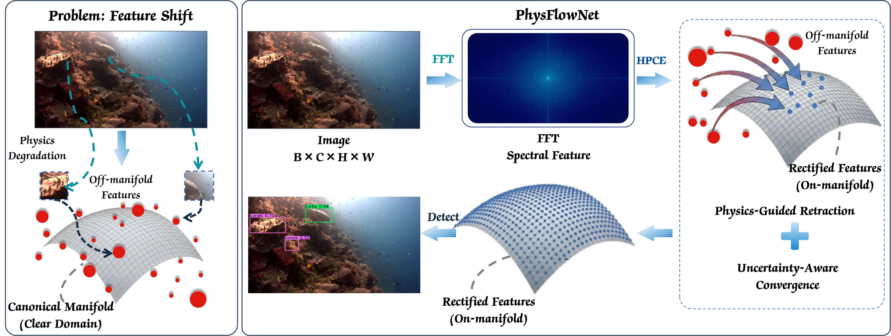

# PhysFlowNet

[中文](README.zh-CN.md) | English

Research implementation of **PhysFlowNet: Learning Canonical Latent Manifolds via Spatio-Spectral Physics Priors for Underwater Object Detection**, accepted at **ECCV 2026**. PhysFlowNet uses image-derived physical priors to guide feature rectification in a YOLO11-based underwater object detector. [Paper](https://doi.org/10.1007/978-3-032-37038-9_35)



*Paper Figure 1. Spatio-spectral physical priors guide the rectification of underwater features.*

## Architecture

| Component | Role in this implementation |
| --- | --- |
| **HPCE** · Hierarchical Physical Context Embedding | Encodes RGB image statistics and frequency-band energies. PPRB combines this global embedding with a local embedding from the semantic features. |
| **PPRB** · Parallel Physics-Residual Bottleneck | Uses the physical condition to estimate a feature displacement and a positive diagonal metric. A metric-preconditioned retraction and a gated residual update rectify the semantic features. |
| **PMD** · Physics-Guided Manifold Downsampling | Fuses a stride-2 convolution with a pooled, reweighted feature branch to preserve local detail across scales. |
| **PhysFlowNet neck and detection head** | `PhysFlowNetNeckRefinement` applies global-prior-conditioned retraction to the three detection scales. `PhysFlowNetDetect` exposes the feature maps required by the training loss. |
| **UECO** · Unified Evidential-Contrastive Objective | Extends the detection objective with the Supervised Contrastive Manifold Loss (SCML) and Evidential Uncertainty Regulation (EUR). |

The model definition is [PhysFlowNet.yaml](PhysFlowNet.yaml). Model modules are in [physflownet.py](ultralytics/nn/modules/physflownet.py), and the training objective is in [loss.py](ultralytics/utils/loss.py).

## Installation

In a fresh Python environment, install a compatible PyTorch and torchvision pair for your CPU or CUDA setup, then install the local Ultralytics fork.

```bash
git clone https://github.com/Mariiiiooooo/PhysFlowNet.git
cd PhysFlowNet
python -m pip install -e .
```

## Training

Prepare a YOLO detection dataset with image splits and corresponding text labels. Create a local dataset YAML with `path`, `train`, `val`, and `names`. The dataset's class count overrides the placeholder in the model YAML.

Run the following from the repository root. Replace `/path/to/dataset.yaml` with your dataset config and `device=0` with `device=cpu` for CPU training.

```bash
yolo detect train model=PhysFlowNet.yaml data=/path/to/dataset.yaml imgsz=640 epochs=300 batch=16 optimizer=SGD pretrained=False amp=False seed=0 lr0=0.01 lrf=0.01 momentum=0.937 weight_decay=0.0005 warmup_epochs=3.0 device=0
```

After training, use your own checkpoint for validation or inference.

```bash
yolo detect val model=/path/to/best.pt data=/path/to/dataset.yaml
yolo detect predict model=/path/to/best.pt source=/path/to/images
```

## Reproducing the paper

This repository contains the selected research implementation and its model config. The training command uses the paper's reported 300-epoch schedule. Local scripts associated with the original source directory used 400 epochs for some runs.

This implementation samples ground-truth box centers for SCML and adds an auxiliary cosine-alignment term. The paper describes SCML on assigner-selected foreground anchors. The retained YAML most closely matches the paper's reported model size among the checked local configs.

Reproducing the paper's reported scores requires the exact dataset versions and splits, the original model and training configuration, and the paper implementation and software environment. Evaluating the reported trained models also requires their original checkpoints. Obtain datasets and checkpoints separately.

## Citation

Xueting Liu, Haoyu Ji, Wenze Huang, Zhihao Yang, Yu Gao, Weihong Ren, Zhiyong Wang, and Honghai Liu. *PhysFlowNet: Learning Canonical Latent Manifolds via Spatio-Spectral Physics Priors for Underwater Object Detection*. ECCV 2026, pp. 613–631. [DOI](https://doi.org/10.1007/978-3-032-37038-9_35)


```bibtex
@inproceedings{liu2026physflownet,
  author    = {Liu, Xueting and Ji, Haoyu and Huang, Wenze and Yang, Zhihao and
               Gao, Yu and Ren, Weihong and Wang, Zhiyong and Liu, Honghai},
  title     = {{PhysFlowNet}: Learning Canonical Latent Manifolds via
               Spatio-Spectral Physics Priors for Underwater Object Detection},
  booktitle = {Computer Vision -- ECCV 2026},
  series    = {Lecture Notes in Computer Science},
  volume    = {17076},
  pages     = {613--631},
  year      = {2026},
  doi       = {10.1007/978-3-032-37038-9_35}
}
```

## License

Based on [Ultralytics YOLO](https://github.com/ultralytics/ultralytics) 8.3.209 and distributed under [AGPL-3.0](LICENSE). The 2026-11-26 research release renames the project modules to match the paper terminology and extracts the selected architecture and training code from the local fork.
