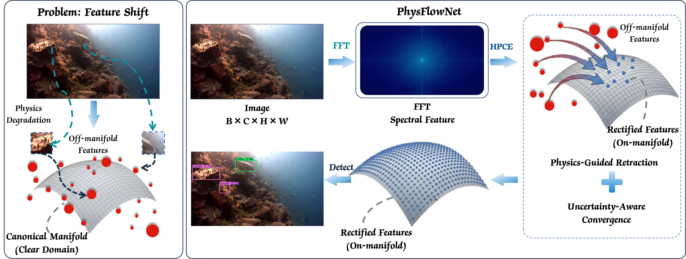

# PhysFlowNet

中文 | [English](README.md)

已被 **ECCV 2026** 接收的论文 **PhysFlowNet: Learning Canonical Latent Manifolds via Spatio-Spectral Physics Priors for Underwater Object Detection** 的研究实现。PhysFlowNet 在 YOLO11 水下目标检测器中使用从图像提取的物理先验，引导特征校正。 [论文](https://doi.org/10.1007/978-3-032-37038-9_35)



*论文图 1。空频物理先验为水下图像的特征校正提供条件。*

## 模型结构

| 模块 | 在本实现中的作用 |
| --- | --- |
| **HPCE** · 分层物理上下文嵌入 | 编码 RGB 图像统计量与各频带能量。PPRB 将全局嵌入与从语义特征提取的局部嵌入结合。 |
| **PPRB** · 并行物理残差瓶颈 | 在物理条件下估计特征位移和正对角度量，通过度量预条件的黎曼回缩与门控残差更新校正语义特征。 |
| **PMD** · 物理引导的流形下采样 | 融合步幅为 2 的卷积分支与重加权池化分支，在跨尺度下采样时保留局部细节。 |
| **PhysFlowNet 颈部和检测头** | `PhysFlowNetNeckRefinement` 在三个检测尺度应用全局先验引导的回缩。`PhysFlowNetDetect` 返回训练损失所需的特征图。 |
| **UECO** · 统一证据对比目标 | 在检测损失上加入监督对比流形损失（SCML）和证据不确定性正则项（EUR）。 |

模型定义见 [PhysFlowNet.yaml](PhysFlowNet.yaml)，模型模块见 [physflownet.py](ultralytics/nn/modules/physflownet.py)，训练损失见 [loss.py](ultralytics/utils/loss.py)。

## 安装

在独立的 Python 环境中，先安装与 CPU 或 CUDA 环境兼容的 PyTorch 和 torchvision，然后安装本仓库中的 Ultralytics 派生版本。

```bash
git clone https://github.com/Mariiiiooooo/PhysFlowNet.git
cd PhysFlowNet
python -m pip install -e .
```

## 训练

准备 YOLO 检测格式的图像划分及相应的文本标注。创建本地数据集 YAML，并设置 `path`、`train`、`val` 和 `names`。训练时会按数据集类别数覆盖模型 YAML 中的占位类别数。

在仓库根目录运行以下命令。将 `/path/to/dataset.yaml` 替换为你的数据集配置路径。使用 CPU 时将 `device=0` 改为 `device=cpu`。

```bash
yolo detect train model=PhysFlowNet.yaml data=/path/to/dataset.yaml imgsz=640 epochs=300 batch=16 optimizer=SGD pretrained=False amp=False seed=0 lr0=0.01 lrf=0.01 momentum=0.937 weight_decay=0.0005 warmup_epochs=3.0 device=0
```

训练结束后，可使用自己的检查点进行验证或推理。

```bash
yolo detect val model=/path/to/best.pt data=/path/to/dataset.yaml
yolo detect predict model=/path/to/best.pt source=/path/to/images
```

## 论文复现

仓库提供选定的研究实现和对应的模型配置。上面的训练命令采用论文报告的 300 个 epoch。

要复现论文表格中的结果，需要使用准确的数据集版本与划分、原始模型与训练配置，以及论文实验对应的实现和软件环境。复测论文中已训练的模型还需要对应的原始检查点。数据和检查点需另行获取。

## 引用

Xueting Liu、Haoyu Ji、Wenze Huang、Zhihao Yang、Yu Gao、Weihong Ren、Zhiyong Wang 和 Honghai Liu。*PhysFlowNet: Learning Canonical Latent Manifolds via Spatio-Spectral Physics Priors for Underwater Object Detection*。ECCV 2026，613–631 页。 [DOI](https://doi.org/10.1007/978-3-032-37038-9_35)


```bibtex
@inproceedings{liu2026physflownet,
  author    = {Liu, Xueting and Ji, Haoyu and Huang, Wenze and Yang, Zhihao and
               Gao, Yu and Ren, Weihong and Wang, Zhiyong and Liu, Honghai},
  title     = {{PhysFlowNet}: Learning Canonical Latent Manifolds via
               Spatio-Spectral Physics Priors for Underwater Object Detection},
  booktitle = {Computer Vision -- ECCV 2026},
  series    = {Lecture Notes in Computer Science},
  volume    = {17076},
  pages     = {613--631},
  year      = {2026},
  doi       = {10.1007/978-3-032-37038-9_35}
}
```

## 许可

本仓库基于 [Ultralytics YOLO](https://github.com/ultralytics/ultralytics) 8.3.209，按 [AGPL-3.0](LICENSE) 许可发布。2026-11-26 的研究发布版按论文术语统一了项目模块名称，并整理了选定的模型和训练代码。
